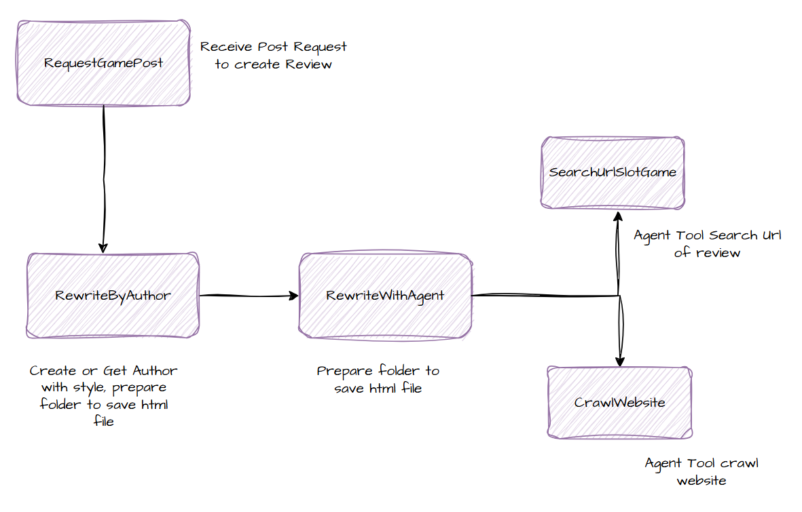
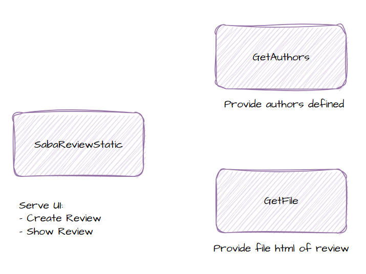

# 🛠️ How to Use Workflows in n8n

This guide walks you through setting up and using workflows in **n8n**, an open-source workflow automation tool.

---

## 📁 Preparation

### 1. Create a Folder for saving html file

The path is: `/tmp/saba-review2`

### 2. Create a Data Table

If your workflow involves storing or retrieving data, you may need a table.

#### Option A: Using n8n's Built-in Data (via `Data` node or `SQLite`)

- Add a **Database** node (e.g., SQLite or PostgreSQL).
- Use a `CREATE TABLE` SQL query in the node:

```sql
CREATE TABLE public.writer (
	id serial4 NOT NULL,
	"name" varchar NOT NULL,
	"style" varchar NOT NULL,
	folder varchar NULL,
	CONSTRAINT writer_pk PRIMARY KEY (id)
);
```

---

## ⚙️ Creating a Workflow

1. Go to your folder and click **➕ New Workflow**.
2. Import from file and choose item suitable.
3. Check sub workflow node and some credential.

---

## ✅ Workflow description

### Main Flow



### UI Flow


